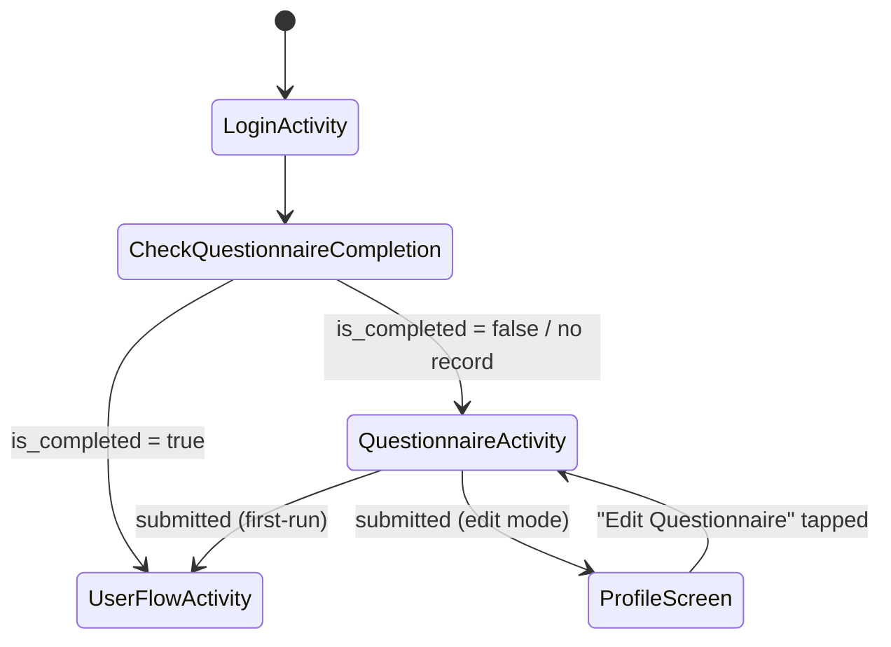

# Design Document: Onboarding Questionnaire

## Overview

This document describes the technical design for the 14-screen user onboarding questionnaire feature. The feature introduces a `QuestionnaireActivity` that intercepts post-login navigation when a user has not yet completed personalisation. It adds a new Room entity, extends `ProfileEntity`, adds a Firestore collection, and integrates into the existing sync pipeline.

The implementation touches five of the six existing modules:
- **`data`** — new entity, DAO, migration, DTO, repository impl, FirebaseRemoteClient extension, FirebaseSyncRunner extension
- **`domain`** — new repository interface, new domain model `OnboardingResponse`
- **`app`** — new `QuestionnaireActivity`, new `QuestionnaireViewModel`, modified `LoginActivity`, modified `ProfileScreen`

The `presentation` and `core:poseengine` modules are unchanged.

---

## Architecture

The feature follows the existing Clean Architecture pattern in the project:

```
app (UI)
  QuestionnaireActivity ──► QuestionnaireViewModel
  LoginActivity (modified)
  ProfileScreen (modified)
        │
        ▼ (Hilt injected)
domain
  OnboardingRepository (interface)
  OnboardingResponse (domain model)
        │
        ▼ (Hilt binding)
data
  OnboardingRepositoryImpl
  OnboardingResponseDao
  OnboardingResponseEntity
  FirestoreOnboardingDto
  FirebaseRemoteClient (extended)
  FirebaseSyncRunner (extended)
  DatabaseMigrations.MIGRATION_5_6
```

### Navigation Flow



### Questionnaire Page Flow

```
Page 0: Age Group (single-choice)
Page 1: Gender (single-choice)
Page 2: Primary Goal (single-choice)
Page 3: Yoga Experience (single-choice)
Page 4: Preferred Yoga Style (single-choice)
Page 5: Flexibility Level (single-choice)
Page 6: Focus Areas (multi-select)
Page 7: Height (numeric + unit toggle)
Page 8: Weight (numeric + unit toggle)
Page 9: Daily Practice Time (single-choice)
Page 10: Weekly Frequency (single-choice)
Page 11: Injuries (multi-select)
Page 12: Medical Conditions (multi-select)
Page 13: Camera Permission (single-choice / action)
Page 14: Summary + "Start Your Journey"
```

---

## Components and Interfaces

### 1. Domain Model — `OnboardingResponse`

Location: `domain/src/main/java/com/domain/model/OnboardingResponse.kt`

```kotlin
data class OnboardingResponse(
    val userId: String,
    val ageGroup: String?,
    val gender: String?,
    val goal: String?,
    val experienceLevel: String?,
    val yogaStyle: String?,
    val flexibilityLevel: String?,
    val focusAreas: String?,         // comma-separated
    val heightCm: Int?,
    val weightKg: Double?,
    val dailyPracticeMinutes: Int?,
    val weeklyFrequency: String?,
    val injuries: String?,           // comma-separated; "none" if None selected
    val medicalConditions: String?,  // comma-separated
    val cameraPermissionGranted: Boolean?,
    val isCompleted: Boolean,
    val updatedAtEpochMs: Long,
)
```

### 2. Domain Repository Interface — `OnboardingRepository`

Location: `domain/src/main/java/com/domain/repository/OnboardingRepository.kt`

```kotlin
interface OnboardingRepository {
    suspend fun saveAnswers(answers: OnboardingResponse): Result<Unit>
    suspend fun getAnswers(userId: String): OnboardingResponse?
    fun observeAnswers(userId: String): Flow<OnboardingResponse?>
    suspend fun isCompleted(userId: String): Boolean
}
```

### 3. Room Entity — `OnboardingResponseEntity`

Location: `data/src/main/java/com/data/local/entity/OnboardingResponseEntity.kt`

```kotlin
@Entity(tableName = "onboarding_responses")
data class OnboardingResponseEntity(
    @PrimaryKey val user_id: String,
    val age_group: String?,
    val gender: String?,
    val goal: String?,
    val experience_level: String?,
    val yoga_style: String?,
    val flexibility_level: String?,
    val focus_areas: String?,
    val height_cm: Int?,
    val weight_kg: Double?,
    val daily_practice_minutes: Int?,
    val weekly_frequency: String?,
    val injuries: String?,
    val medical_conditions: String?,
    val camera_permission_granted: Int?,  // 0 or 1
    val is_completed: Int,                // 0 or 1
    val updated_at: Long,
)
```

### 4. Room DAO — `OnboardingResponseDao`

Location: `data/src/main/java/com/data/local/dao/OnboardingResponseDao.kt`

```kotlin
@Dao
interface OnboardingResponseDao {
    @Insert(onConflict = OnConflictStrategy.REPLACE)
    suspend fun upsert(entity: OnboardingResponseEntity)

    @Query("SELECT * FROM onboarding_responses WHERE user_id = :userId LIMIT 1")
    suspend fun getByUserId(userId: String): OnboardingResponseEntity?

    @Query("SELECT * FROM onboarding_responses WHERE user_id = :userId LIMIT 1")
    fun observeByUserId(userId: String): Flow<OnboardingResponseEntity?>

    @Query("SELECT is_completed FROM onboarding_responses WHERE user_id = :userId LIMIT 1")
    suspend fun isCompleted(userId: String): Int?  // null = no record
}
```

### 5. Firestore DTO — `FirestoreOnboardingDto`

Location: `data/src/main/java/com/data/remote/firebase/FirestoreDtos.kt` (appended)

```kotlin
@Serializable
data class FirestoreOnboardingDto(
    val user_id: String,
    val age_group: String? = null,
    val gender: String? = null,
    val goal: String? = null,
    val experience_level: String? = null,
    val yoga_style: String? = null,
    val flexibility_level: String? = null,
    val focus_areas: String? = null,
    val height_cm: Int? = null,
    val weight_kg: Double? = null,
    val daily_practice_minutes: Int? = null,
    val weekly_frequency: String? = null,
    val injuries: String? = null,
    val medical_conditions: String? = null,
    val camera_permission_granted: Boolean? = null,
    val is_completed: Boolean,
    val updated_at: Long,
) {
    fun toMap(): Map<String, Any?> = mapOf(
        "user_id" to user_id,
        "age_group" to age_group,
        "gender" to gender,
        "goal" to goal,
        "experience_level" to experience_level,
        "yoga_style" to yoga_style,
        "flexibility_level" to flexibility_level,
        "focus_areas" to focus_areas,
        "height_cm" to height_cm,
        "weight_kg" to weight_kg,
        "daily_practice_minutes" to daily_practice_minutes,
        "weekly_frequency" to weekly_frequency,
        "injuries" to injuries,
        "medical_conditions" to medical_conditions,
        "camera_permission_granted" to camera_permission_granted,
        "is_completed" to is_completed,
        "updated_at" to updated_at,
    )
}
```

### 6. Data Repository Implementation — `OnboardingRepositoryImpl`

Location: `data/src/main/java/com/data/repository/OnboardingRepositoryImpl.kt`

Injected dependencies: `OnboardingResponseDao`, `SyncQueueDao`, `FirebaseRemoteClient`, `Json`

Key behaviour:
- `saveAnswers()`: upserts locally via DAO, then attempts Firestore upsert; on Firestore failure, enqueues to `sync_queue` with `entityType = "onboarding_responses"`.
- `isCompleted()`: checks local DB first; if no record, falls back to Firestore fetch and saves locally if found.

### 7. Extended `FirebaseRemoteClient`

Two new suspend functions:

```kotlin
suspend fun upsertOnboardingResponse(dto: FirestoreOnboardingDto)
suspend fun fetchOnboardingResponse(userId: String): FirestoreOnboardingDto?
```

Targeting Firestore collection `onboarding_responses`, document ID = `userId`. Follow the same `SetOptions.merge()` pattern as existing profile upserts.

### 8. Extended `FirebaseSyncRunner`

Add a new `"onboarding_responses"` branch in the `when (item.entityType)` block:

```kotlin
"onboarding_responses" -> {
    val dto = json.decodeFromString<FirestoreOnboardingDto>(item.payload)
    firebaseRemoteClient.upsertOnboardingResponse(dto)
}
```

### 9. Database Migration — `MIGRATION_5_6`

```kotlin
val MIGRATION_5_6: Migration = object : Migration(5, 6) {
    override fun migrate(db: SupportSQLiteDatabase) {
        // New table
        db.execSQL("""
            CREATE TABLE IF NOT EXISTS onboarding_responses (
                user_id TEXT NOT NULL PRIMARY KEY,
                age_group TEXT,
                gender TEXT,
                goal TEXT,
                experience_level TEXT,
                yoga_style TEXT,
                flexibility_level TEXT,
                focus_areas TEXT,
                height_cm INTEGER,
                weight_kg REAL,
                daily_practice_minutes INTEGER,
                weekly_frequency TEXT,
                injuries TEXT,
                medical_conditions TEXT,
                camera_permission_granted INTEGER,
                is_completed INTEGER NOT NULL DEFAULT 0,
                updated_at INTEGER NOT NULL
            )
        """.trimIndent())

        // Extend profiles table
        db.execSQL("ALTER TABLE profiles ADD COLUMN age_group TEXT")
        db.execSQL("ALTER TABLE profiles ADD COLUMN gender TEXT")
        db.execSQL("ALTER TABLE profiles ADD COLUMN experience_level TEXT")
        db.execSQL("ALTER TABLE profiles ADD COLUMN yoga_style TEXT")
        db.execSQL("ALTER TABLE profiles ADD COLUMN flexibility_level TEXT")
        db.execSQL("ALTER TABLE profiles ADD COLUMN focus_areas TEXT")
        db.execSQL("ALTER TABLE profiles ADD COLUMN daily_practice_minutes INTEGER")
        db.execSQL("ALTER TABLE profiles ADD COLUMN weekly_frequency TEXT")
        db.execSQL("ALTER TABLE profiles ADD COLUMN injuries TEXT")
        db.execSQL("ALTER TABLE profiles ADD COLUMN medical_conditions TEXT")
        db.execSQL("ALTER TABLE profiles ADD COLUMN camera_permission_granted INTEGER")
    }
}
```

### 10. `QuestionnaireActivity`

Location: `app/src/main/java/com/posemonitor2/questionnaire/QuestionnaireActivity.kt`

- Annotated `@AndroidEntryPoint`.
- Reads `EXTRA_MODE` from intent (`"first_run"` | `"edit"`); defaults to `"first_run"`.
- In edit mode, reads `EXTRA_USER_ID` from intent to load existing answers.
- Hosts the full-screen Compose `QuestionnaireFlow` composable.
- Handles camera permission result via `rememberLauncherForActivityResult(ActivityResultContracts.RequestPermission)`.

```kotlin
companion object {
    const val EXTRA_MODE = "extra_questionnaire_mode"
    const val MODE_FIRST_RUN = "first_run"
    const val MODE_EDIT = "edit"

    fun firstRunIntent(context: Context): Intent =
        Intent(context, QuestionnaireActivity::class.java)
            .putExtra(EXTRA_MODE, MODE_FIRST_RUN)

    fun editIntent(context: Context): Intent =
        Intent(context, QuestionnaireActivity::class.java)
            .putExtra(EXTRA_MODE, MODE_EDIT)
}
```

### 11. `QuestionnaireViewModel`

Location: `app/src/main/java/com/posemonitor2/questionnaire/QuestionnaireViewModel.kt`

```kotlin
@HiltViewModel
class QuestionnaireViewModel @Inject constructor(
    private val onboardingRepository: OnboardingRepository,
    private val profileRepository: ProfileRepository,
    private val authRepository: AuthRepository,
) : ViewModel()
```

**State:**

```kotlin
data class QuestionnaireUiState(
    val currentPage: Int = 0,
    val mode: String = QuestionnaireActivity.MODE_FIRST_RUN,
    val answers: AnswerState = AnswerState(),
    val isLoading: Boolean = false,
    val isSaved: Boolean = false,
    val saveError: String? = null,
)

data class AnswerState(
    val ageGroup: String? = null,
    val gender: String? = null,
    val goal: String? = null,
    val experienceLevel: String? = null,
    val yogaStyle: String? = null,
    val flexibilityLevel: String? = null,
    val focusAreas: Set<String> = emptySet(),
    val heightCm: Int? = null,
    val weightKg: Double? = null,
    val dailyPracticeMinutes: Int? = null,
    val weeklyFrequency: String? = null,
    val injuries: Set<String> = emptySet(),
    val medicalConditions: Set<String> = emptySet(),
    val cameraPermissionGranted: Boolean? = null,
)
```

**Key functions:**
- `loadExistingAnswers(userId)` — called in edit mode to pre-populate `AnswerState`.
- `setAnswer(page, value)` — dispatches the correct field update based on page index.
- `toggleMultiSelectOption(page, option)` — handles add/remove with None-deselects-others logic.
- `setHeight(rawInput, isMetric)` — converts to cm and updates `heightCm`.
- `setWeight(rawInput, isMetric)` — converts to kg and updates `weightKg`.
- `isNextEnabled(page)` — returns `true` when the current page has a valid answer.
- `submitAnswers(userId)` — calls `onboardingRepository.saveAnswers()` and `profileRepository.upsertProfile()`.

**Unit conversion utilities** (pure functions, testable):

```kotlin
fun ftInToCm(feet: Int, inches: Int): Int = ((feet * 30.48) + (inches * 2.54)).roundToInt()
fun cmToFtIn(cm: Int): Pair<Int, Int>    // returns (feet, inches)
fun lbToKg(lb: Double): Double = lb * 0.453592
fun kgToLb(kg: Double): Double = kg * 2.20462
```

### 12. Modified `LoginActivity`

The `onAuthenticated` lambda changes from a direct `UserFlowActivity` launch to:

```kotlin
onAuthenticated = { email ->
    lifecycleScope.launch {
        val userId = authViewModel.getCurrentUserId() ?: return@launch
        val completed = onboardingRepository.isCompleted(userId)
        val intent = if (completed) {
            Intent(this@LoginActivity, UserFlowActivity::class.java)
        } else {
            QuestionnaireActivity.firstRunIntent(this@LoginActivity)
        }.apply {
            flags = Intent.FLAG_ACTIVITY_NEW_TASK or Intent.FLAG_ACTIVITY_CLEAR_TASK
        }
        startActivity(intent)
        finish()
    }
}
```

The `OnboardingRepository` is injected into `LoginActivity` via `@Inject`.

### 13. Modified `ProfileScreen` and `ProfileViewModel`

**ProfileViewModel additions:**
- Observes `OnboardingRepository.observeAnswers(userId)` and exposes `questionnaireSummary: QuestionnaireSummary?` in the UI state.

**ProfileScreen additions:**
1. "Your Yoga Profile" card above "App Settings" card — shows goal, experience level, focus areas.
2. "Edit Questionnaire" row inside the "App Settings" card using the same `SettingsRow` style.

---

## Data Models

### Updated `ProfileEntity`

The 11 new nullable columns are added to the existing entity. The existing mapper chain (`toDomain`, `toEntity`, `toFirestoreDto`, `FirestoreProfileDto.toEntity`) is extended to map these fields.

```kotlin
@Entity(tableName = "profiles")
data class ProfileEntity(
    // ... existing fields unchanged ...
    @ColumnInfo(name = "age_group")           val ageGroup: String? = null,
    @ColumnInfo(name = "gender")              val gender: String? = null,
    @ColumnInfo(name = "experience_level")    val experienceLevel: String? = null,
    @ColumnInfo(name = "yoga_style")          val yogaStyle: String? = null,
    @ColumnInfo(name = "flexibility_level")   val flexibilityLevel: String? = null,
    @ColumnInfo(name = "focus_areas")         val focusAreas: String? = null,
    @ColumnInfo(name = "daily_practice_minutes") val dailyPracticeMinutes: Int? = null,
    @ColumnInfo(name = "weekly_frequency")    val weeklyFrequency: String? = null,
    @ColumnInfo(name = "injuries")            val injuries: String? = null,
    @ColumnInfo(name = "medical_conditions")  val medicalConditions: String? = null,
    @ColumnInfo(name = "camera_permission_granted") val cameraPermissionGranted: Int? = null,
)
```

### Updated `UserProfile`

Mirrors the new `ProfileEntity` fields with Kotlin-native types (`Boolean?` instead of `Int?` for the permission flag).

### `OnboardingResponse` → `OnboardingResponseEntity` mapper chain

```
OnboardingResponse.toEntity()    : OnboardingResponseEntity
OnboardingResponseEntity.toDomain(): OnboardingResponse
OnboardingResponse.toFirestoreDto(): FirestoreOnboardingDto
FirestoreOnboardingDto.toEntity() : OnboardingResponseEntity
```

These mappers live in `data/src/main/java/com/data/repository/mapper/ModelMappers.kt`.

---

## Correctness Properties

*A property is a characteristic or behavior that should hold true across all valid executions of a system — essentially, a formal statement about what the system should do. Properties serve as the bridge between human-readable specifications and machine-verifiable correctness guarantees.*

### Property 1: Progress indicator value matches page index

*For any* page index `p` in the range `[0, 14]`, the `LinearProgressIndicator` fraction shown by the questionnaire SHALL equal `p.toFloat() / 14f`.

**Validates: Requirements 2.2**

---

### Property 2: Back navigation decrements page

*For any* questionnaire state where `currentPage > 0`, invoking the Back action SHALL result in `currentPage` being decremented by exactly 1.

**Validates: Requirements 2.3**

---

### Property 3: Next is disabled without a required answer

*For any* single-choice or numeric-input page where `isNextEnabled(page) = false`, the "Next" button SHALL remain non-clickable regardless of what other state fields are set.

**Validates: Requirements 2.7, 2.8**

---

### Property 4: Single-choice selection is mutually exclusive

*For any* single-choice question page, if option A was previously selected and option B is selected, then the set of selected options SHALL contain exactly `{B}` — i.e., A is deselected.

**Validates: Requirements 3.1, 3.3**

---

### Property 5: Multi-select toggle round-trip

*For any* multi-select question page and any option O, toggling O twice (select then deselect) SHALL leave the selected options set unchanged from its state before either toggle.

**Validates: Requirements 4.1**

---

### Property 6: None option deselects all others (mutual exclusion invariant)

*For any* multi-select question page that has a "None" option (Screens 12 and 13), selecting "None" SHALL result in `selectedOptions == {"None"}` regardless of which other options were previously selected.

**Validates: Requirements 4.6, 4.9**

---

### Property 7: Non-None selection deselects None

*For any* multi-select question page where "None" is currently selected, selecting any non-"None" option SHALL result in "None" being removed from the selected options set.

**Validates: Requirements 4.7, 4.10**

---

### Property 8: Height unit conversion round-trip

*For any* valid height value `h` in centimetres (where `h >= 30 && h <= 300`), converting to ft/in and then back to cm SHALL yield a value within ±1 cm of `h`.

**Validates: Requirements 5.2, 5.3**

---

### Property 9: Weight unit conversion round-trip

*For any* valid weight value `w` in kilograms (where `w >= 20.0 && w <= 500.0`), converting to lb and then back to kg SHALL yield a value within ±0.1 kg of `w`.

**Validates: Requirements 5.4, 5.6**

---

### Property 10: Empty or non-numeric input disables Next on numeric screens

*For any* string `s` that is blank or cannot be parsed as a positive number, passing `s` as the height or weight input SHALL leave `isNextEnabled` as `false` for that screen.

**Validates: Requirements 5.7**

---

### Property 11: Summary screen contains all four required fields

*For any* `AnswerState` where `goal`, `experienceLevel`, `focusAreas`, and `dailyPracticeMinutes` are set, the summary composable rendered from that state SHALL contain text representations of all four values.

**Validates: Requirements 7.1**

---

### Property 12: Saving answers updates ProfileEntity height, weight, and goal

*For any* `OnboardingResponse` where `heightCm`, `weightKg`, and `goal` are non-null, calling `submitAnswers()` and succeeding SHALL result in `ProfileRepository.upsertProfile()` being called with a `UserProfile` whose `heightCm`, `weightKg`, and `fitnessGoal` match the questionnaire values.

**Validates: Requirements 7.4**

---

### Property 13: OnboardingResponse serialization round-trip

*For any* `OnboardingResponse`, converting it to `FirestoreOnboardingDto` via `toFirestoreDto()`, then reconstructing an `OnboardingResponse` via `toEntity().toDomain()`, SHALL yield an object equal to the original.

**Validates: Requirements 10.1**

---

### Property 14: Comma-separated multi-select serialization round-trip

*For any* non-empty `Set<String>` of option labels with no commas in individual labels, serialising to a comma-separated string and then splitting by `","` and converting back to a `Set<String>` SHALL yield the original set.

**Validates: Requirements 4.3**

---

## Error Handling

| Scenario | Handling |
|---|---|
| `isCompleted()` DB error at login | Catch `Exception`, log, fall back to launching `QuestionnaireActivity` (fail-safe) |
| `saveAnswers()` DB failure | `Result.failure`; UI shows Snackbar; answers remain in ViewModel state for retry |
| Firestore upsert failure during save | Enqueue to `sync_queue`; surface no error to user |
| `fetchOnboardingResponse()` network error during `isCompleted` | Treat as "not completed" (no crash); existing local record checked first |
| Invalid unit conversion input | `isNextEnabled` stays `false`; inline field error shown below input |
| Camera permission runtime dialog dismissed | Set `camera_permission_granted = false` silently; allow progression |

---

## Testing Strategy

### Unit Tests (Example-Based)

- `QuestionnaireViewModelTest`: verify navigation intent routing (`isCompleted=true` → `UserFlowActivity`, `isCompleted=false` → `QuestionnaireActivity`).
- `QuestionnaireViewModelTest`: verify `setAnswer` correctly updates each of the 14 fields.
- `QuestionnaireViewModelTest`: verify camera permission `DENIED` sets `cameraPermissionGranted = false`.
- `DatabaseMigrationTest`: run migration 5→6 against a v5 schema and verify the new table and columns exist.
- `OnboardingRepositoryImplTest`: verify `isCompleted` returns `false` when no DB record and no Firestore record.
- `OnboardingRepositoryImplTest`: verify Firestore failure enqueues to `sync_queue`.

### Property-Based Tests

The project uses JUnit 4 and MockK. Property-based tests use [kotest-property](https://kotest.io/docs/proptest/property-based-testing.html) (`io.kotest:kotest-property:5.9.1`) added to the `data` and `app` module test dependencies.

Minimum 100 iterations per property test. Each test is tagged with the corresponding design property.

**Tests to write (one test per property):**

- Property 1: Generate page indices 0..14, assert `progress == page / 14f`
- Property 2: Generate page state with `currentPage > 0`, assert back decrements
- Property 3: Generate page+answer combinations where answer is absent, assert `isNextEnabled = false`
- Property 4: Generate a page and two distinct option selections A then B, assert `selectedOptions == {B}`
- Property 5: Generate multi-select state and option, toggle twice, assert set unchanged
- Property 6: Generate multi-select state with any prior selections, select None, assert `{None}`
- Property 7: Generate multi-select state with None selected, select any non-None, assert None removed
- Property 8: Generate cm values in [30, 300], round-trip through ft/in, assert within ±1 cm
- Property 9: Generate kg values in [20.0, 500.0], round-trip through lb, assert within ±0.1 kg
- Property 10: Generate blank/non-numeric strings, assert `isNextEnabled = false` for numeric screens
- Property 11: Generate `AnswerState` with all four summary fields, render summary, assert all present
- Property 12: Generate `OnboardingResponse` with non-null metrics, call submit, capture `upsertProfile` arg
- Property 13: Generate `OnboardingResponse`, round-trip through DTO mapper, assert equality
- Property 14: Generate `Set<String>` of option labels, round-trip through comma-separated serialization

### Integration Tests

- Verify that after `QuestionnaireActivity` submits, the `UserFlowActivity` receives an intent (Robolectric).
- Verify `FirebaseSyncRunner.syncPending()` handles `onboarding_responses` entityType without throwing.
